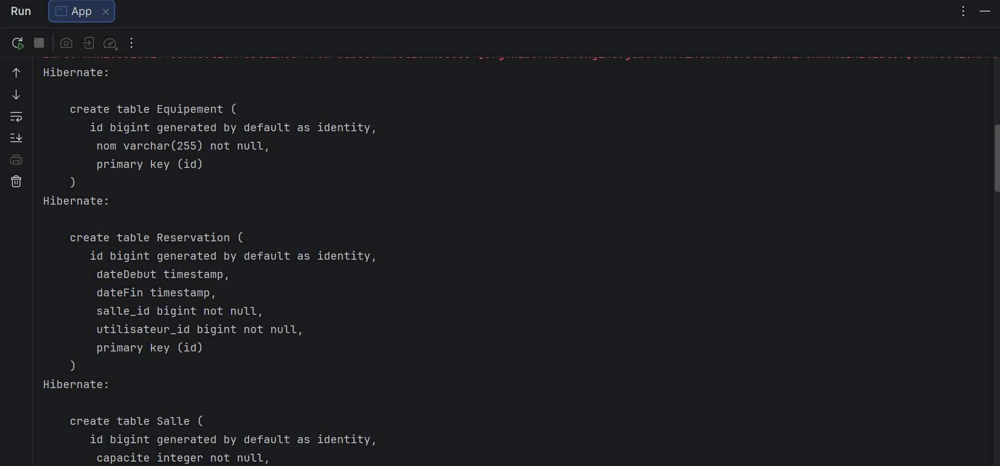
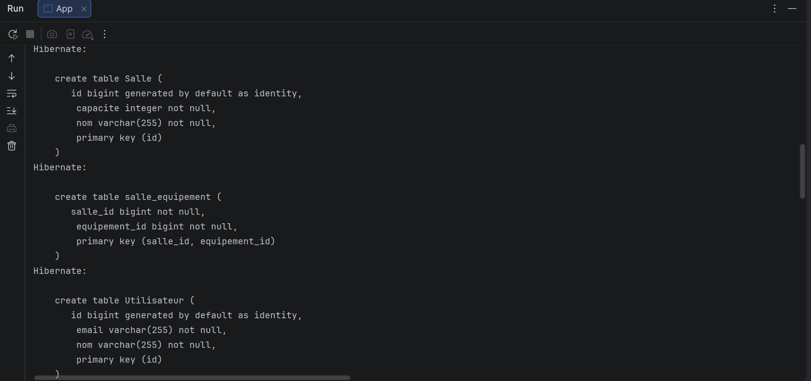

# TP3 : Gestion avancée des entités (Salle, Réservation, Utilisateur, Équipement) avec JPA et Hibernate

## Description

Application Java (sans EJB ni serveur d'applications) qui gère des **utilisateurs**, des
**salles**, des **équipements** et des **réservations** avec JPA et Hibernate. La base est
une H2 en mémoire et les transactions sont gérées manuellement avec `EntityManager`.

## Technologies

- Java [11 / 17 / 21]
- Maven
- Hibernate 5.6.15.Final (JPA 2.2, `javax.persistence`)
- H2 2.1.214 (en mémoire)

## Structure du projet

```
src/main/java/com/example/
├── App.java                          # Scénario de démonstration
├── model/                            # Utilisateur, Salle, Equipement, Reservation
└── service/ReservationService.java   # Disponibilité, requêtes JPQL, gestion d'erreurs
src/main/resources/META-INF/persistence.xml   # Unité : gestion-reservations-pu
```

## Modèle de données

| Relation | Type | Côté propriétaire |
|---|---|---|
| Utilisateur → Reservation | OneToMany / ManyToOne | `Reservation.utilisateur` |
| Salle → Reservation | OneToMany / ManyToOne | `Reservation.salle` |
| Salle ↔ Equipement | ManyToMany (table `salle_equipement`) | `Salle.equipements` |

- `cascade = ALL` et `orphanRemoval = true` sur les réservations : supprimer un utilisateur
  ou une salle supprime ses réservations.
- Pas de cascade `REMOVE` sur le ManyToMany : un équipement partagé n'est jamais supprimé
  avec une salle.
- Les méthodes `addReservation` et `addEquipement` gardent les deux côtés des relations
  synchronisés.

## Lancer le projet

```bash
mvn clean compile exec:java -Dexec.mainClass="com.example.App"
```

## Résultats

### 1. Création des tables Equipement et Reservation



Grâce à `hibernate.hbm2ddl.auto` et à `hibernate.show_sql` / `hibernate.format_sql`,
Hibernate génère le schéma SQL à partir des entités et l'affiche dans la console :

- **Table `Equipement`** : `id` (clé primaire auto-générée) et `nom` (texte, non nul).
- **Table `Reservation`** : `id`, `dateDebut` et `dateFin` (type `timestamp`, issus de
  `LocalDateTime`), ainsi que `salle_id` et `utilisateur_id`. Ces deux colonnes sont
  **`not null`** : c'est la clé étrangère du côté propriétaire des relations `@ManyToOne`
  (`@JoinColumn(nullable = false)`). Une réservation ne peut donc exister sans salle ni
  utilisateur.

### 2. Création des tables Salle, salle_equipement et Utilisateur



La suite des logs montre :

- **Table `Salle`** : `id`, `capacite` (entier, non nul) et `nom` (texte, non nul).
- **Table `salle_equipement`** : table de jointure de la relation **ManyToMany** entre
  `Salle` et `Equipement`. Elle contient `salle_id` et `equipement_id`, tous deux non nuls,
  avec une **clé primaire composite** `(salle_id, equipement_id)` : une même association
  ne peut pas être enregistrée deux fois.
- **Table `Utilisateur`** : `id`, `email` et `nom` (non nuls). Elle n'a pas de colonne vers
  `Reservation`, car `Utilisateur.reservations` est le côté inverse (`mappedBy`) : la clé
  étrangère se trouve dans `Reservation`.

Hibernate crée d'abord les tables, puis ajoute les contraintes (clés étrangères et
unicité du `nom` de salle, de l'`email` et du `nom` d'équipement) avec des `alter table`.

## Exercices supplémentaires

- Validation des dates avec `@PrePersist` / `@PreUpdate` (début < fin)
- Vérification de disponibilité d'une salle sur une période
- Requêtes JPQL : réservations d'un utilisateur, salles équipées d'un équipement donné
- Gestion des exceptions avec rollback et exception métier `GestionException`

## Difficultés rencontrées
- Cohérence `javax.persistence` / `jakarta.persistence` selon la version d'Hibernate
- `TransientPropertyValueException` : il faut persister aussi la salle (`em.persist(salle)`)
- Appel d'une méthode d'instance de façon statique (`Reservation.setDateDebut`)

## Auteur

Zakaria Laalyej, 2DSI, 2026
